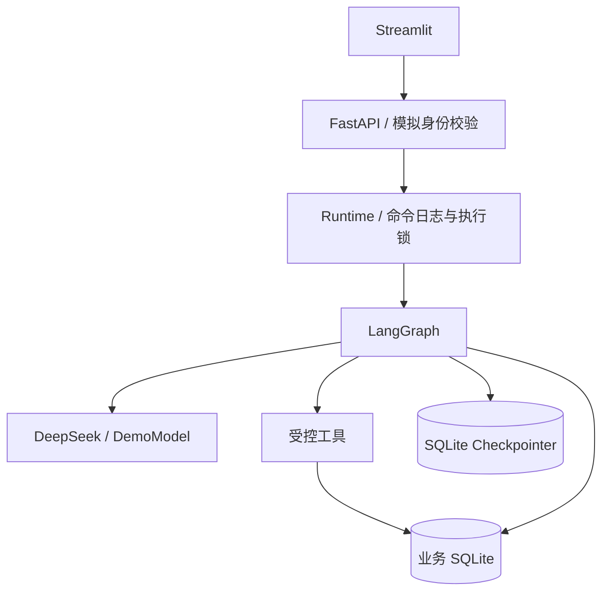
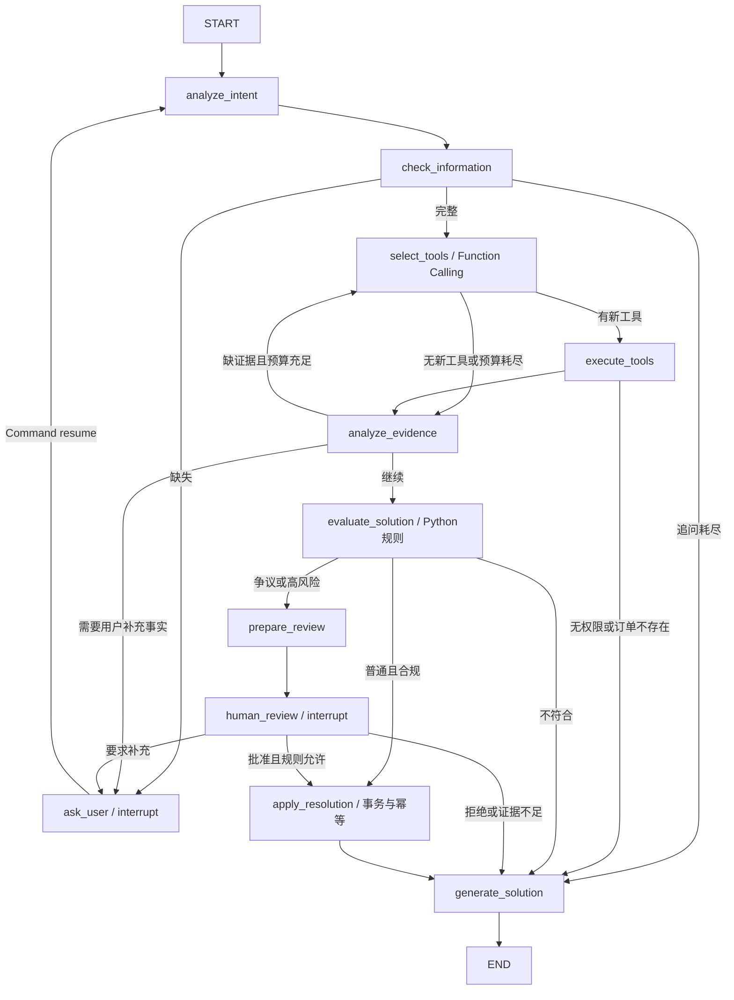

# AfterSales Copilot

基于 LangGraph 的多轮智能售后决策 Agent。自然语言输入 → 收集缺失信息 → 选择并执行查询工具 → 证据分析 → 确定性规则 → 自动模拟处理 / 人工审核 → 有依据的回复。

**本项目为本地面试演示系统。政策、客服历史、订单和业务操作均为模拟，不连接支付或物流。无需 Docker、向量数据库或其他服务。**

## 页面演示

完整操作截图见 [页面截图与演示流程](docs/screenshots/README.md)，包括首页、多轮追问、普通售后、争议判定、人工审核和审批后恢复。


以上截图来自实际运行的本地页面，使用明确标注的离线演示模式，订单、政策及业务操作均为模拟。

## 快速运行

已安装依赖后，在项目目录执行 `powershell -ExecutionPolicy Bypass -File .\start.ps1`，即可后台启动前后端。等待显示页面地址后，访问 http://127.0.0.1:8511。重复执行会跳过健康的服务；启动日志在 `data/logs`。电脑重启后需再次启动。

推荐 Python 3.11。以下命令均在本项目目录执行（不是上级 RAG 项目）。

```powershell
python -m venv .venv
.\.venv\Scripts\python.exe -m pip install -r requirements.txt
Copy-Item .env.example .env
.\start.ps1 backend
```

另开一个终端：

```powershell
.\start.ps1 frontend
```

如果 PowerShell 不允许运行脚本，可以直接使用：

```powershell
.\.venv\Scripts\python.exe -m uvicorn backend.main:app --host 127.0.0.1 --port 8011 --workers 1
.\.venv\Scripts\python.exe -m streamlit run frontend/app.py --server.address 127.0.0.1 --server.port 8511
```

两条启动命令分别在两个终端执行。前端：http://127.0.0.1:8511；API 文档：http://127.0.0.1:8011/docs。

默认 `MODEL_MODE=demo`，无需密钥即可演示所有流程。页面明确显示离线模式：这时意图提取和工具选择来自确定性模拟模型，不能把演示结果宣传为真实 LLM 效果。

接入真实模型时，修改 `.env` 后重启后端：

```dotenv
MODEL_MODE=deepseek
DEEPSEEK_API_KEY=填入自己的密钥
DEEPSEEK_BASE_URL=https://api.deepseek.com
DEEPSEEK_MODEL=deepseek-flash
```

模型名称可按账户实际支持的模型调整；所选模型必须支持 JSON 模式和 Function Calling。适配器显式关闭 thinking，使用独立调用提取信息、选择工具和分析证据。没有密钥不会偷偷降级为演示模式。`.env` 不应提交到 Git。

复现本次已验证的 Windows / Python 3.11 依赖组合，可以使用 `pip install -r requirements.lock.txt`；常规安装使用 `requirements.txt`。

## 三个核心演示

初次启动自动用 `INSERT OR IGNORE` 写入数据，重启不会重置订单，也不会改变已存在订单的日期。

| 场景 | 操作 | 预期 |
| --- | --- | --- |
| A 缺少信息 | 用户一输入“耳机只有一边有声音，我想换货”，追问后输入“订单 A1002” | 同一会话恢复，查询订单与政策，模拟登记换货 |
| B 普通售后 | 用户一输入“A1002 耳机坏了，我要退款” | 选择订单及政策工具，不查询无关历史，模拟登记退款 |
| C 争议售后 | 用户一输入“A1001 耳机只有一边有声音，客服之前拒绝了，我要换货” | 多查询客服历史，发现七天/包装拒绝理由与质量换货政策冲突，等待管理员 |

场景 C 后切换为管理员，填写理由并选择通过、拒绝或要求补充信息。审批后切回用户一，在历史会话中打开原会话查看结果。等待审核期间可以关闭后端并重新启动，待审核记录和中断仍保留。

同一个 A1002 在场景 A/B 成功处理后不能再次操作；如需依次独立演示，请先停止前后端，再把整个 `data` 目录重命名备份，重新启动生成新数据。不要只删除业务库或只删除检查点库。

其他种子订单：A1003 已超一年保修；A2001 属于用户二，用户一不能查询。订单签收日期以首次生成种子数据时为基准。

## 架构和模块

```text
frontend/app.py         Streamlit 聊天、证据面板和审核界面
backend/main.py         FastAPI、请求模型校验和演示令牌认证
backend/runtime.py      命令日志、thread_id 绑定、恢复和执行锁
backend/graph.py        StateGraph 节点、条件边和 interrupt
backend/state.py        显式会话状态
backend/model.py        DeepSeek 适配器 / 可替换离线模拟模型
backend/tools.py        工具白名单、参数校验和订单归属检查
backend/policy.py       确定性资格判断、期限和历史冲突校验
backend/storage.py      SQLite 事务、模拟数据、审批及业务操作
tests/                 API、工作流、恢复、故障与 Streamlit 交互测试
data/business.db       订单、政策、历史、会话、审批、操作及执行事件
data/checkpoints.db    LangGraph SQLite Checkpointer
```



## 工作流



### 状态和上下文

每个 session 对应固定 LangGraph `thread_id`。订单号、诉求、消息、缺失字段、工具证据、方案和审批状态都在 State 中传递，无全局用户会话字典。

同一申请支持多轮补充；结束后新诉求需新建会话，避免在已执行的订单上复用任务。LLM 意图提取最多读取最近 24 条消息；追问最多 3 次、工具最多 12 次、工具规划最多 6 轮，节点总执行还受递归上限约束。已成功查询的同类证据不重复查询；订单改变时清空旧证据。第一版不是无限长对话记忆系统。

### 工具和 LLM 边界

真实模型通过 `tools` 参数返回 Function Calling，后端使用 Pydantic 验证白名单工具和参数。工具选择由任务和已有结果决定：普通问题只需订单和政策；提及客服争议则需要历史。

工具身份来自后端认证，不接受模型传入 user_id。每个工具都会检查订单归属；政策的商品类型由真实订单决定。未知证据 ID 会被拒绝。输入的客服记录与用户文本作为不可信数据传给模型。

模型负责提取、选工具、归纳和措辞；Python 负责期限、金额、资格和权限。模型发现潜在冲突只能升级人工，不能放宽资格。最终业务结论由模板展示；模型措辞单独保留为非权威解释字段，前端不把它当业务结果展示。

### 演示政策

- 签收七天内可申请整单退款；金额超过 200 元需要审核。
- 质量问题签收三十天内可以申请换货，丢失包装盒不单独导致拒绝。
- 超过换货期限但仍在一年保修期内，只建议联系维修，不伪造维修工单。
- 用户提出客服争议时查询历史并转人工；针对种子历史中的“超过七天/丢失包装拒绝质量换货”，执行确定性的政策冲突识别。
- 订单已退款、已有售后或状态不合法时不再次执行。
- 时间以 UTC 保存，资格以申请时间计算；金额使用整数分。
- 政策是模拟数据，不能当作真实平台规则或法律结论。

### 审批、事务与恢复

`prepare_review` 幂等写审批记录，`human_review` 只负责中断和读取恢复结果。恢复会重跑中断节点，因此不能在中断前直接退款。管理员只能批准或拒绝规则允许的操作，不能以审批绕过证据不足和资格限制。

业务更新前刷新订单和政策。操作编号按会话唯一、订单操作记录有唯一约束；写操作记录、更新订单状态在同一个 `BEGIN IMMEDIATE` 事务中。重复执行读取原结果，两个会话争抢同一订单时后者不再更新。

业务库与检查点库不共享事务。Runtime 在调用图前持久化待执行命令和目标 interrupt ID：如果进程崩溃，重发同一个请求或点击重试，根据当前检查点判断命令是否已被消费，再继续未完成节点，不把同一条补充错误地交给下一个追问。

等待用户或审批的会话重启后无需重跑，直接从检查点恢复。执行中失败的会话保留 pending，需显式重试；本项目不承诺启动后自动调度所有未完成任务。

同进程使用执行锁串行化运行，**后端必须单 worker**。这适合本地演示，多个用户会等待前一个模型调用；不声称支持分布式并发。扩展时需增加任务队列、数据库并发控制、分布式会话锁及版本迁移。

## API 与身份

所有业务接口要求 `Authorization: Bearer <token>`。默认令牌：

| 账户 | token | 作用 |
| --- | --- | --- |
| 用户一 | demo-user-token | 自己的会话和 A1001/A1002/A1003 |
| 用户二 | demo-other-token | 自己的会话和 A2001 |
| 管理员 | demo-admin-token | 待审核列表和审批 |

前端账户切换仅便于演示，后端仍会校验令牌和归属。正式部署需要替换认证机制并限制管理员访问，不能把本地演示账户选择器暴露到公网。

| 方法 | 路径 | 用途 |
| --- | --- | --- |
| GET | /health | 模式及健康状态 |
| POST | /chat/start | 新建任务；message、request_id |
| POST | /chat/message | 回答追问；session_id、message、request_id |
| GET | /sessions | 当前身份的历史会话 |
| GET | /session/{session_id} | 对话、状态、证据和事件 |
| POST | /session/{session_id}/retry | 恢复未完成命令，最多三次 |
| GET | /orders | 当前用户订单 |
| GET | /reviews/pending | 管理员待审核列表 |
| POST | /reviews/{review_id}/decision | approve / reject / request_info，附 reason |

`request_id` 为客户端生成的 UUID。同一用户重复提交同一开始请求返回原会话；同一会话重复补充返回当前状态。相同 request_id 不同内容返回 409；已决定的审批不能覆盖原决定。503 响应返回可恢复的 session_id，内部供应商错误和密钥不会写到 API 响应。

## 测试与限制

```powershell
.\start.ps1 test
# 或
.\.venv\Scripts\python.exe -m pytest -q
```

测试使用临时业务库和检查点库，不改演示订单。包括三个场景、重启恢复、补充审核、权限、重复请求、并发审批、模型失败、回复降级、工具/追问预算，以及“业务已提交但检查点未提交”后的恢复。Streamlit AppTest 覆盖聊天输入和管理员操作；模型适配器测试用模拟 API 响应验证真实模式协议，不调用收费 API。

真实 DeepSeek 网络效果必须在用户配置密钥后单独测量，不能把 DemoModel 的测试通过率当作真实模型准确率。完整运行记录见 `VALIDATION.md`。

需要验证真实 HTTP 与进程重启时，运行 `.venv\Scripts\python.exe scripts\verify_live.py`。脚本自动选择空闲端口、使用临时数据库并在结束时关闭测试服务。

SQLite 文件、检查点及事件可能含对话内容，勿提交真实个人数据。第一版没有真实退款、物流、向量检索、后台队列、多人分布式调度、任意政策语义冲突证明和生产认证。

## 面试讲解顺序

1. 用 A/B/C 展示不同工具集合、真实状态分支及人工恢复。
2. 打开 `graph.py` 解释 State、Node、条件边和 interrupt。
3. 打开 `model.py` 对比真实 Function Calling 与离线模拟。
4. 打开 `policy.py` 解释模型建议和确定性授权的边界。
5. 打开 `storage.py` 和崩溃恢复测试，说明检查点不等于业务事务、幂等如何补足。
6. 说明单 worker、模拟账户和真实 LLM 尚需测量的边界。

## 官方参考

- [LangGraph Interrupts](https://docs.langchain.com/oss/python/langgraph/interrupts)
- [LangGraph Persistence](https://docs.langchain.com/oss/python/langgraph/persistence)
- [DeepSeek Tool Calls](https://api-docs.deepseek.com/guides/tool_calls/)
- [DeepSeek JSON Output](https://api-docs.deepseek.com/guides/json_mode/)
