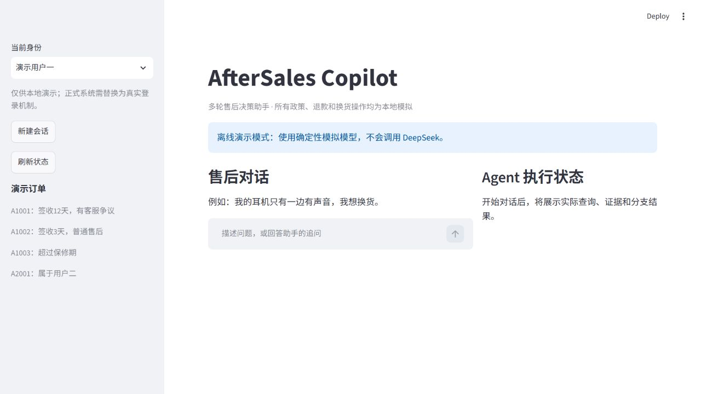
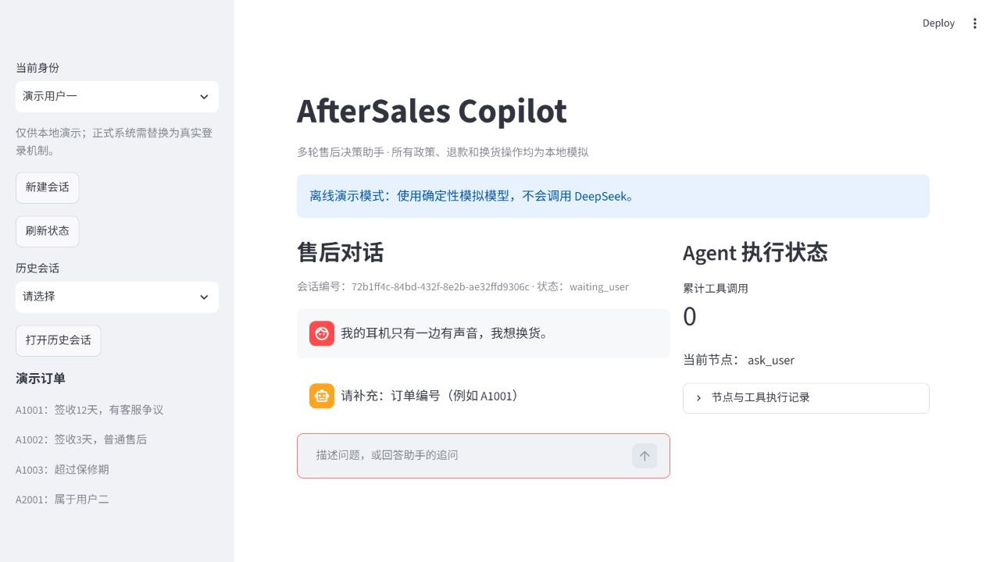
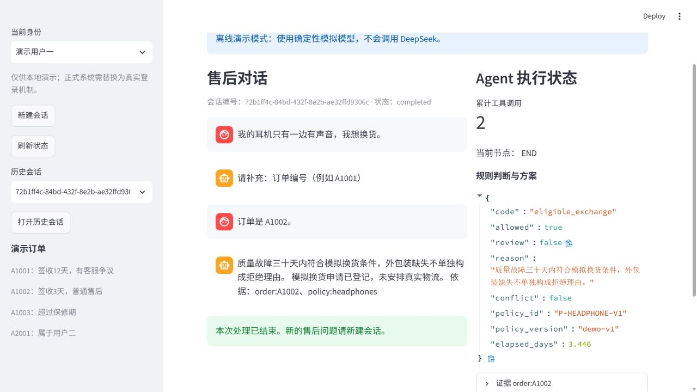
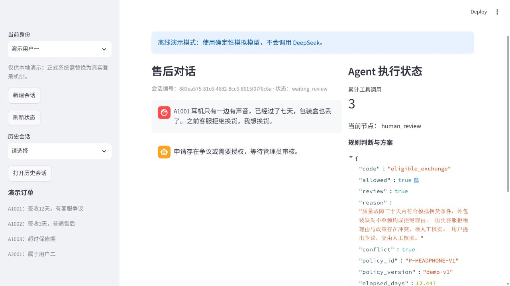
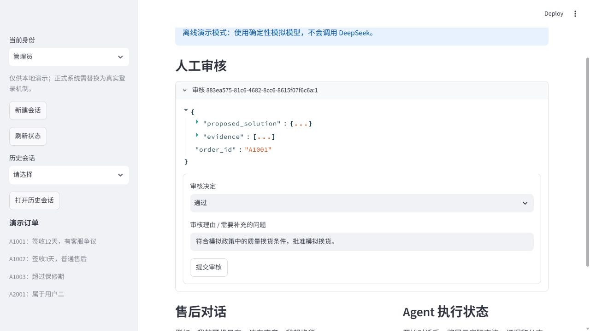
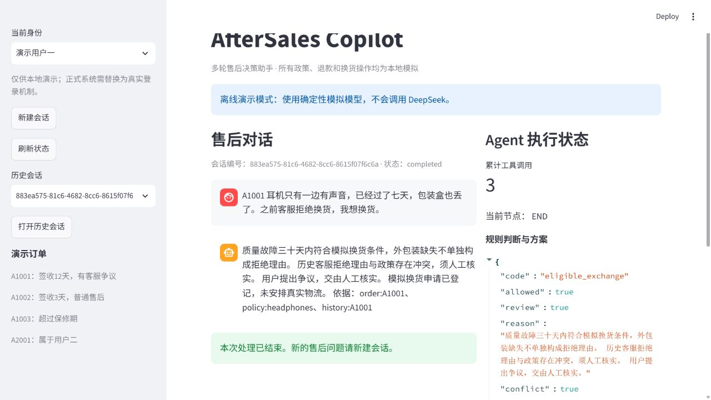

# 页面截图与演示流程

以下六张截图均来自实际运行的 Streamlit 页面，未经内容修改。当前模式为 `demo`，使用模拟模型和本地模拟业务数据，不代表真实 DeepSeek 的效果评测。截图通过页面实际交互完成，展示同一任务从追问到处理、从争议到审核恢复的过程。

## 1. 页面总览

展示用户身份切换、历史会话、售后聊天和 Agent 执行面板。

## 2. 多轮追问

用户描述耳机故障和换货意图，但没有提供订单号。工作流暂停在 `ask_user`，主动追问订单编号；此时尚未调用查询工具。

## 3. 补充信息后完成普通售后

用户在同一会话中补充 A1002。系统查询订单和政策，两次工具调用后判断符合规则，登记模拟换货，并展示依据和完成状态。

## 4. 争议判定与人工中断

用户为 A1001 提出换货申请，并指出客服曾拒绝。系统额外查询客服历史，累计三次工具调用；规则结果包含 `conflict: true`，工作流暂停在 `human_review`。

## 5. 管理员审核

管理员查看对应订单、处理方案和证据后，选择通过、拒绝或补充信息。为同时展示操作表单，截图中已折叠长 JSON 详情；完整冲突依据可见上一张截图。

## 6. 审批后恢复完成

管理员通过本次模拟申请后，用户重新打开原会话。工作流已恢复至 `END`，会话状态为 `completed`，显示模拟换货登记结果，以及订单、政策和历史三类证据引用。

## 复现说明

按照主 [README](../../README.md) 启动服务，依次使用 A1002 演示多轮补充、A1001 演示客服争议，再切换管理员进行审批即可。截图演示已对当前模拟订单登记售后；同一订单不会重复处理。需要重新演示时，请先停止服务，将整个 `data` 目录备份重命名，再启动生成新数据。
